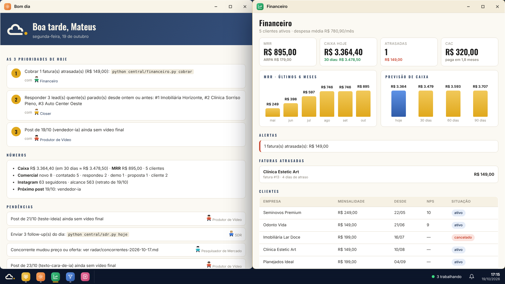

# Equipe de agentes da Ciello

Treze agentes especialistas em `.claude/agents/`, coordenados por cinco comandos em `.claude/skills/`. A sessão principal do Claude Code é o **coordenador**: recebe o pedido, divide entre os agentes, junta os resultados e pede a aprovação do Mateus.

| Agente | Cor | Função | Ferramentas principais |
|---|---|---|---|
| **pesquisador-mercado** | ciano | Tendências dos 5 pilares, concorrentes e biblioteca de ganchos | `central/radar.py`, `central/ganchos.py`, Metricool (concorrentes), busca web |
| **roteirista** | — | Pauta → roteiros com gancho validado e fontes | `roteiros/*.json`, `ganchos.py modelos` |
| **produtor-video** | vermelho | Narração, Remotion (I.V.A. ou clone), montagem final | `voz.py`, `render.mjs`, `CloneReel`, `mixar.py`, notebook do Kaggle |
| **produtor-imagem** | laranja | Capas, carrosséis, criativos de anúncio | `capa.mjs`, stills no Remotion |
| **postagem** | verde | Legenda, horário, agendamento, histórico | Metricool |
| **analista** | roxo | Retrato semanal, relatório, aprendizado | `relatorio.py`, `metricas/` |
| **sdr** | azul | Leads, qualificação, 1ª mensagem, follow-up | `central/sdr.py`, Google Maps (gosom), Vibe Prospecting (custo aprovado) |
| **closer** | amarelo | Objeções, demonstração, proposta, agenda | Gamma, Gmail (rascunho), Google Agenda |
| **gestor-anuncios** | rosa | Plano e leitura de anúncios Meta | relatório do analista, criativos dos produtores |
| **chefe-gabinete** | laranja | Resumo do dia com as 3 prioridades, delega, cobra pendências, placar de sexta | `central/briefing.py` |
| **financeiro** | verde | Assinaturas, faturas, cobrança 3/7/14 dias, extrato OFX, caixa, MRR/churn/CAC/LTV | `central/financeiro.py` |
| **caixa-entrada** | azul | Triagem do e-mail, rascunhos, horários de demo | conectores Gmail e Google Agenda (só rascunho) |
| **sucesso-cliente** | rosa | FAQ, onboarding, NPS, pedido de avaliação no Google, risco de cancelamento | `financeiro.py posvenda`, `comercial/faq.md` |

Origem dos 4 novos: o reel "10 agentes de IA que toda empresa devia ter". Avaliação de cada um em `docs/qualificacao.md`.

## Comandos

| Comando | Quando | Quem trabalha |
|---|---|---|
| `/semana` | domingo | pesquisador → roteirista (3 em paralelo) → produtor-video + produtor-imagem (em paralelo) → postagem |
| `/comercial` | todo dia útil | sdr + closer em paralelo → lista única: enviar, responder, agendar |
| `/bom-dia` | todo dia de manhã | chefe-gabinete → caixa-entrada, financeiro, sucesso-cliente e sdr conforme o briefing → uma tela com as 3 prioridades |
| `/sexta` | sexta à tarde | placar (chefe-gabinete) + resumo financeiro + vigia de concorrentes (pesquisador) + voz do cliente → uma decisão para a semana |
| `/segunda` | segunda de manhã | analista + pesquisador em paralelo → gestor-anuncios |
| `/conselho` | decisões de negócio (preço, oferta, onde investir) | Founder skills (conselho, CFO, painel de 100 compradores, marketing…) com os dados reais da Ciello |

Também dá para chamar um agente direto: "use o sdr para gerar 20 leads de odontologia em Xanxerê".

## Escritório: pixel-agents original

O escritório é o [pixel-agents](https://github.com/pablodelucca/pixel-agents) **original**, sem nenhuma alteração no código. É instalado pelo npm na versão fixada **1.5.0** (MIT, © Pablo De Lucca; personagens baseados no [Metro City, de JIK-A-4](https://jik-a-4.itch.io/metrocity-free-topdown-character-pack)). Ele roda em modo standalone, no navegador, sem VS Code.

**Abrir:** clique duas vezes em `Escritorio-Ciello.cmd` (ou `python central/escritorio/abrir.py`). O lançador:
1. confere o Node.js 20+;
2. instala na primeira vez o layout da Ciello em `~/.pixel-agents/layout.json`, guardando backup do anterior (`--layout` reinstala);
3. sobe `npx pixel-agents@1.5.0 --port 3100` **na pasta do assistente**, que é o que faz o escritório acompanhar as sessões do Claude Code desta pasta;
4. abre o navegador com o token.

**Primeira vez:** a apresentação do pixel-agents pede para instalar os hooks do Claude Code. Aceite: é o modo mais preciso.

**O layout da Ciello** (`central/escritorio/layout-ciello.json`, gerado por `gerar_layout.py` com os mesmos móveis e módulos do layout padrão):

| Sala | Áreas | Lugares |
|---|---|---|
| Esquerda | **Pesquisa** (em cima) e **Estúdio** (embaixo) | 4 estações |
| Meio | **Comercial**: mesa da equipe de vendas e sofás para demonstração | 4 cadeiras + sofás |
| Direita | **Análise & Anúncios** (em cima) e **Postagem** (embaixo) | 4 estações |

O editor **Layout** do próprio pixel-agents continua funcionando para mudar o que quiser.

**Como os agentes aparecem:**
- **Com equipes ligadas** (`CLAUDE_CODE_EXPERIMENTAL_AGENT_TEAMS=1` no `.claude/settings.json` do seu PC): `/semana`, `/comercial` e `/segunda` criam teammates com o nome de cada agente (sdr, closer, pesquisador-mercado…). Cada um senta numa mesa com o nome em cima. As equipes são experimentais e gastam mais uso.
- **Sem equipes:** os agentes rodam como subagentes e aparecem como personagens ao lado do coordenador, com o balão mostrando "sdr: follow-ups do dia".
- **Animações do próprio pixel-agents:** digitando quando trabalha, "…" quando pede permissão, ✓ quando termina, passeio pelo escritório quando está livre.

## Ciello OS: o app inteiro numa área de trabalho

Clique duas vezes em **`Ciello.cmd`**. Abre numa janela própria do Edge (ou Chrome), sem barra de endereço, como um programa instalado: fundo azul com a logo da Ciello, ícones na área de trabalho e uma **barra de tarefas** embaixo, igual ao Windows.

- **Escritório de agentes** (ícone fixado com o alfinete dourado): o pixel-agents original dentro de uma janela, com a lista da equipe ao lado. O `Ciello.cmd` liga o pixel-agents sozinho; se estiver desligado, a janela tem o botão **Ligar escritório**.
- **Clicar em um agente** (no escritório, no menu Iniciar ou em Equipe) abre a janela dele: o que faz, o que está fazendo agora, botões para rodar as funções dele e as últimas atividades.
- **Quando um agente começa a trabalhar**, aparece um aviso no canto e a janela dele abre sozinha (desligue no menu Iniciar).
- **Botões das janelas** (ex.: "Cobranças do dia", "Checar concorrentes agora") rodam a ferramenta e abrem uma janela com a saída ao vivo. Só rodam as ações da lista fixa do `servidor.py`, e só a partir do próprio app.
- **Janelas:** arrastar pela barra de título, redimensionar pelas bordas e cantos, duplo clique para maximizar, arrastar até a borda esquerda/direita para ocupar metade da tela (até o topo maximiza), minimizar para a barra de tarefas. A posição de cada janela fica salva.
- **Apps:** Bom dia (3 prioridades), Financeiro, Comercial, Conteúdo e Instagram (com as capas), Tendências, Concorrentes, Anúncios, Equipe, Atividade e Verificação.

Interface em `central/escritorio/web/` (HTML, CSS e JavaScript sem dependências; fontes Oswald e Inter, licença OFL).

## Próximas integrações candidatas (foco: métricas, anúncios e crescimento)

| Para | Como | Dependência |
|---|---|---|
| Resultado dos anúncios no painel | Meta Ads conectado ao Metricool (conectores `metaAds`/`facebookAds`) → `anuncios/*.json` | nenhuma nova |
| Atribuição de lead por anúncio ou post | Link do WhatsApp com texto de origem (`?text=Vim pelo anúncio X`) e a etapa no `sdr.py` | nenhuma |
| Agendar demonstrações | feito: caixa-entrada sugere horários (`suggest_time`) e prepara o convite | conector Google Agenda |
| Previsão de crescimento | Projeção de seguidores e clientes no painel a partir dos retratos semanais | nenhuma |

## Funções futuras

- **Agentes com mesa e nome no escritório:** ligar as equipes do Claude Code (`CLAUDE_CODE_EXPERIMENTAL_AGENT_TEAMS=1` no `.claude/settings.json` do PC). Até lá, os agentes aparecem como ajudantes do coordenador, com o nome no balão.
- **Resultado dos anúncios no painel:** Meta Ads conectado ao Metricool, alimentando `anuncios/`.
- **Atribuição de lead por anúncio ou post:** texto de origem no link do WhatsApp.
- **Recepcionista por voz** (atender ligação 24h): precisa de telefonia paga (ex.: número virtual + agente de voz). Fica para quando houver investimento.
- **Atendimento automático 24h no WhatsApp** (suporte sem o Mateus): exige a API oficial do WhatsApp (paga por conversa) e um servidor ligado. Hoje o sucesso-cliente prepara as respostas e o Mateus envia.
- **Contratação** (vaga, triagem, entrevista): quando a Ciello contratar a 1ª pessoa.
- **Previsão de crescimento** no painel, a partir dos retratos semanais.
- **Telas reais do CIELLO CRM** no plano-sequência, a partir de prints.

